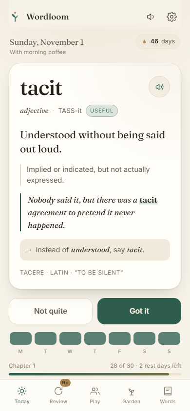
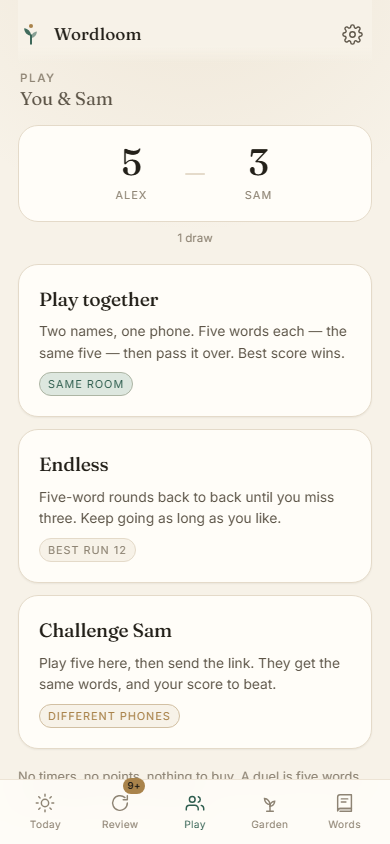

# Wordloom

**One good word a day, and someone to argue about it with.** A phone-first
vocabulary app for adults: a daily word, spaced review, a garden that grows, and
a five-word duel you can play across the table or across the country.

**Live:** <https://appleknife.github.io/wordloom/> — installable, works offline, and
duel links open on any phone.

 

One file of HTML, CSS and JavaScript. No build step, no dependencies, no accounts,
no server. Everything lives in `localStorage` on the device, and the word bank is
inside the file, so it works with the network off.

## Run it

`index.html` is self-contained. Double-click it and it works.

For the installable version — home-screen icon, opens offline — serve the folder:

```powershell
..\serve.ps1
```

then open <http://localhost:8777/wordloom/> and use **Add to Home Screen** on a
phone, or the install icon in Chrome/Edge.

> **Two phones need a URL, not a file.** A `file://` link only opens on the machine
> it lives on, so the challenge links need the published address above. Pass-and-play
> works anywhere, with no network at all.

## What's in it

### Today
One word, big serif, phonetic spelling (`TASS-it`), a speaker button. The meaning
is hidden behind **Show me the meaning** on first encounter — guessing first is
what makes it stick. Then: plain meaning, dictionary line, a sentence you could
actually say, an "instead of *understood*, say *tacit*" swap, and one line of roots.

Underneath, two quiet progress devices: a week strip (green = kept, amber = a rest
day, grey = nothing) and a **chapter** bar — thirty words per chapter, with an
ending, because a finish line motivates more than an infinite grind.

### Review
Whatever is due, up to eight at a time. The question type changes as a word
matures:

| Level | Question |
| --- | --- |
| new → 1 | Which of these means *tacit*? |
| 2 → 3 | Fill the gap: "there was a ___ agreement" (four words) |
| 4 → 6 | Type the missing word from memory |

Recognition first, production later. The summary at the end tells you something
specific — "6 of 8 · three were old friends · two typed from memory" — rather than
telling you you're amazing. **Five more** on that screen deals another round, so a
session is never capped at eight.

### Play
Three ways to play, all five words at a time, all free:

- **Play together** — one phone, two names, the same five words. Player one plays,
  hands over, player two plays. Best score wins. Works anywhere, no internet.
- **Endless** — solo, five-word rounds back to back until you miss three. The score
  climbs across rounds and the best run is kept. This is the "I have twenty
  minutes" mode.
- **Challenge Sam** — play five, then send a link. The link carries the five words
  *and* your score, so the other phone plays the identical round with a number to
  beat. Works across phones, asynchronously, with no server anywhere.

The head-to-head tally stays on each phone. There are no points, no timers, and
nothing to buy.

### Garden
Every word you meet becomes a plant: seed, sprout, leaves, bud, bloom, coloured by
theme. Tap one to reopen its card. It starts empty, which is the point.

### Words
All 143 words, searchable and filterable by useful / stretch / due / learnt / unseen.

## How the schedule works

Every word keeps a level from 0 to 6. **Got it** moves it up; **Not quite** moves it
down one, so a shaky word comes back sooner. The gaps are 1, 2, 4, 8, 16, 32 and
64 days — spaced repetition with no jargon on screen.

In a word's card you can also say **Too easy** (retire it further out) or **Too
hard** (bring it back tomorrow). That is how the app learns what he already knows.

### Weak words come back sooner

Every miss is a lapse, and lapses change the schedule rather than just the level:

- **Three or more lapses** drops the word two levels, makes it due immediately,
  and marks it so it sorts to the front of the queue.
- The review queue is ordered by **need**, not calendar order: days overdue ×2,
  lapses ×5, and how low the level is ×2. A word you keep failing beats a word
  that is merely due.
- If fewer than five words are due, **weak words are pulled forward** even when
  their interval hasn't elapsed, so a struggle never waits a week for attention.
- A missed word is **re-inserted into the same session**, three questions later.
- Duels and Endless use the same weighting, so the words he is worst at are the
  ones most likely to be dealt.

The word card shows the record — *"Met 4 times · missed twice"* — so the extra
attention never feels arbitrary.

## Two rest days a week

The streak is deliberately forgiving. You get **two rest days per week**, spent
automatically on days you miss — so a busy Tuesday does not wipe out a month, and
the strip shows an honest amber dot instead of a zero. Missing a day is not a
failure; it is Tuesday.

Copy throughout avoids the thing the research says backfires: no "you lost your
streak", no red, no guilt.

## A duel without a server

A challenge is a URL with the round inside it:

```
index.html#d=eyJ2IjoxLCJmIjoiU2FtIiwidyI6WyJ0YWNpdCIs...
```

That payload holds the sender's name, the five word ids, and their score. Any phone
that opens it gets the same five words and the same target. Nothing is uploaded,
nothing is looked up, and the "server" is a text message.

## Sound

Small synthesised chimes — no audio files, nothing to download, works offline.
A correct answer plays a note that **climbs as your streak grows**; a miss is a
soft low thud, never a buzzer; a chapter completion gets a slow arpeggio, and a
duel win gets a short flourish.

The speaker in the top bar mutes everything. Settings has a volume slider with a
live preview. Both are saved with the rest of the state.

## The words

143 words, written by hand rather than scraped: a plain meaning, the dictionary
definition, a real sentence, an "instead of" swap, and a root. Two lanes:

- **useful** — *tacit, salient, mitigate, caveat, nuance, candid*
- **stretch** — *perspicacious, obdurate, palimpsest, susurrus*

Mixed roughly **2 useful : 1 stretch** by default, adjustable in Settings or during
setup.

To add words, edit the `WORDS` array in `index.html`:

```js
{w:"mitigate", p:"MIT-ih-gayt", pos:"verb",
 plain:"To make something bad less bad.",
 formal:"To make something bad less severe or serious.",
 ex:"We cannot undo the delay, but we can mitigate it with a clear plan.",
 swap:"soften", root:"mitigare · Latin · “to soothe”",
 theme:"harm", lane:"useful"}
```

## First run

Three short screens: your name, who you are playing with, when you will usually do
this ("with morning coffee"), and how adventurous the words should be. That is the
habit cue and the autonomy, both taken from the motivation research rather than
invented.

## Settings

Name and rival, appearance (auto/light/dark), three text sizes, the daily mix, and
export/import of a JSON backup.

## Privacy

No account, no analytics, no network calls except the optional Google Fonts. The
word bank is local. A backup file and a duel link are the only things that ever
leave the phone, and only when you choose.

## Notes for whoever picks this up

- `index.html?demo` loads 45 days of sample history **in memory only** — it never
  touches saved progress.
- `&view=review|play|garden|words`, `&sheet=mitigate`, `&theme=light|dark` for
  screenshots; `&duel=pass|draft|endless|result` (demo only) jumps into a game state.
- Bump `CACHE` in `sw.js` when the app changes, or installed copies keep the old one.
- The research behind the design decisions is in [RESEARCH.md](RESEARCH.md).
